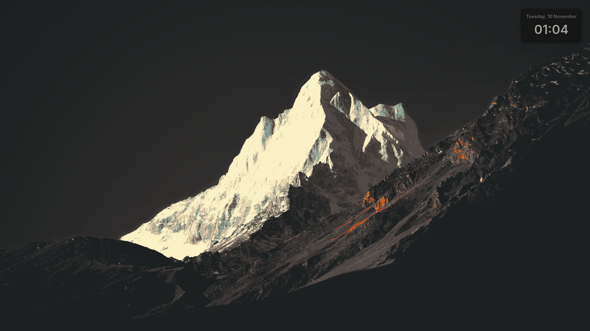
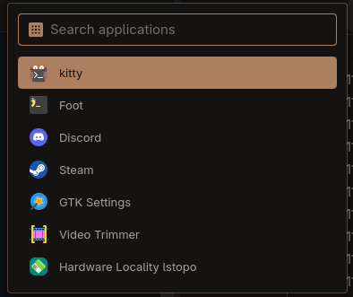

# Dotfiles


My Arch Linux setup: [Niri](https://github.com/YaLTeR/niri) with my [Quickshell](https://github.com/bitterhalt/dotfiles/tree/master/core/.config/quickshell) shell.

<p align="center">
  
</p>

## Philosophy

- **Keyboard driven.** If a widget has buttons, it must also work from the keyboard.
- **Less clutter.** A clear working environment, no giant menus.
- **Simplicity.** Small scripts and plain config files over big frameworks.
- **Speed before eye candy.** This is not a working environment, not unixporn.

  
## Stack

|               |                                                                            |
| ------------- | -------------------------------------------------------------------------- |
| Distro        | [Arch Linux](https://archlinux.org)                                        |
| Compositor    | [Niri](https://github.com/YaLTeR/niri)                                     |
| Shell UI      | [Quickshell](https://quickshell.org/): bar, menus, lock screen, wallpaper  |
| Colors        | [Hellwal](https://github.com/danihek/hellwal)                              |
| Terminal      | [WezTerm](https://wezterm.org/), also my persistent tmux-style multiplexer |
| Editor        | [Neovim](https://neovim.io/)                                               |
| File manager  | [lf](https://github.com/gokcehan/lf)                                       |
| Image viewer  | [swayimg](https://github.com/artemsen/swayimg)                             |
| Media         | [mpv](https://mpv.io/)                                                     |
| Login manager | [ly](https://codeberg.org/fairyglade/ly)                                   |
| Shell         | bash                                                                       |

## Gallery

<table>
  <tr>
    <td width="50%"><br><sub>Zen mode: bar hidden, only a small info card in the corner</sub></td>
    <td width="50%"><br><sub>Application launcher (apps, files, emoji, calculator)</sub></td>
  </tr>
  <tr>
    <td width="50%"><br><sub>Clipboard picker</sub></td>
    <td width="50%"><br><sub>Translator</sub></td>
  </tr>
  <tr>
    <td width="50%"><br><sub>Wallpaper picker</sub></td>
    <td width="50%"><br><sub>Audio controls</sub></td>
  </tr>
  <tr>
    <td width="50%"><br><sub>Bluetooth menu</sub></td>
    <td width="50%"><br><sub>Network menu</sub></td>
  </tr>
  <tr>
    <td width="50%"><br><sub>Notification history</sub></td>
    <td width="50%"><br><sub>Weather forecast</sub></td>
  </tr>
</table>

<p align="center">
  <br>
  <sub>Lock screen</sub>
</p>

### Slimshell (Quickshell)

The shell lives in [`core/.config/quickshell`](core/.config/quickshell). It replaces several separate tools and Bash scripts.

|              | What's included                                                                                               |
| ------------ | ------------------------------------------------------------------------------------------------------------- |
| **Bar**      | Workspaces, window title, clock and weather, battery, connections, privacy indicators, removable drives, tray |
| **Menus**    | Keyboard-driven Bluetooth, Wi-Fi, audio, and notification menus                                               |
| **Launcher** | Apps, quick actions, file search, calculator, emoji, and dmenu mode                                           |
| **Tools**    | Clipboard history, DeepL translator, screen recording, package updates                                        |
| **Session**  | Lock screen, idle handling, polkit prompt, wallpaper picker, dynamic theming                                  |

Niri keybinds and scripts control it over IPC:

```bash
qs ipc call launcher toggle
qs ipc call volume up
qs ipc call lock lock
```

The full target list is in the [Slimshell README](core/.config/quickshell/README.md).

## Install

> These are personal dotfiles. Read before copying, and expect to adapt them.
> No warranty; back up your data.

Requires [GNU Stow](https://www.gnu.org/software/stow/)

```bash
git clone git@github.com:bitterhalt/dotfiles.git "$HOME/dotfiles"
DOTFILES="$HOME/dotfiles"

ln -sfn "$DOTFILES/core/.stowrc" ~/.stowrc
cd "$DOTFILES"
stow -R apps bin core
```
