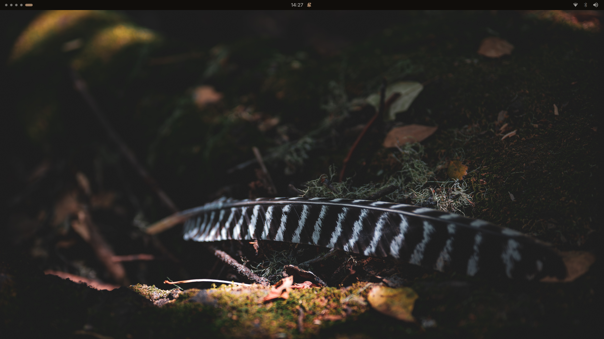
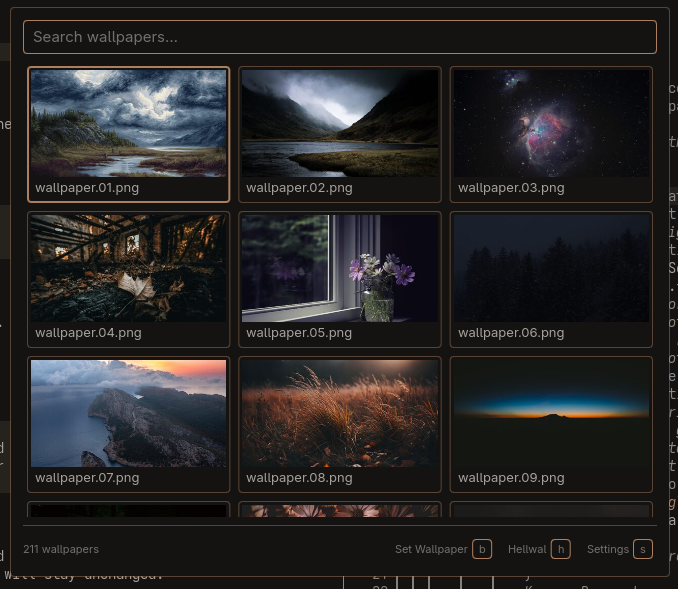
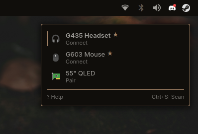

# Dotfiles

- Philosophy:
  - Keyboard driven workflow
  - Less clutter - a clear working environment
  - Simplicity
  - Speed before eye candy

### Current Stack

- Distro: [Arch](https://archlinux.org)
- Bar, launcher and widgets: [Quickshell](https://quickshell.org/)
- WM: [Niri](https://github.com/niri-wm/niri)
- Colors [Hellwal](https://github.com/danihek/hellwal)
- Editor: [NeoVim](https://neovim.io/)
- Filemanager: [lf](https://github.com/gokcehan/lf/)
- Image Viewer: [swayimg](https://github.com/artemsen/swayimg)
- Login Manager: [ly](https://codeberg.org/fairyglade/ly)
- Media Player: [mpv](https://mpv.io/)
- Terminal: [Westerm](https://wezterm.org/index.html)

## Gallery

  

  

<table>
  <tr>
    <td width="50%"> Clipboard picker</td>
    <td width="50%"> Translator</td>
  </tr>
  <tr>
    <td width="50%"> Wallpaper picker</td>
    <td width="50%"> Audio controls</td>
  </tr>
  <tr>
    <td width="50%"> Bluetooth menu</td>
    <td width="50%"> Network menu</td>
  </tr>
  <tr>
    <td width="50%"> Notification history</td>
    <td width="50%"> Weather forecast</td>
  </tr>
</table>

   
  Application launcher

   
  Lock screen

### Binds

- **[Keybindings](desktop/.config/niri/keybinds.md)**

---

### User reviews ❤️

### [⭐ Inspiration](https://github.com/bitterhalt?tab=stars)
