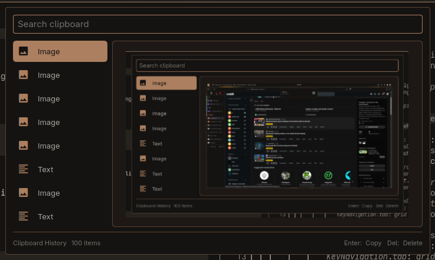
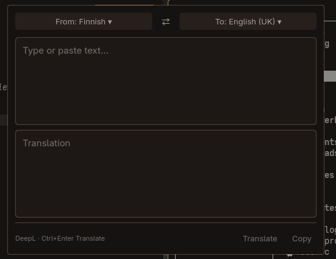
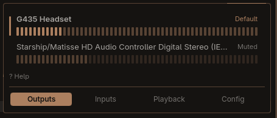
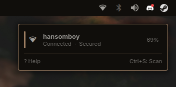
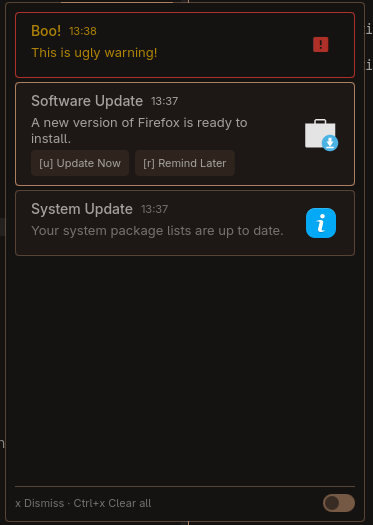
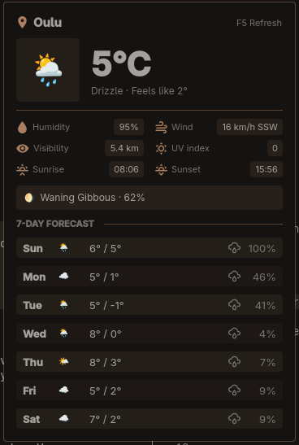
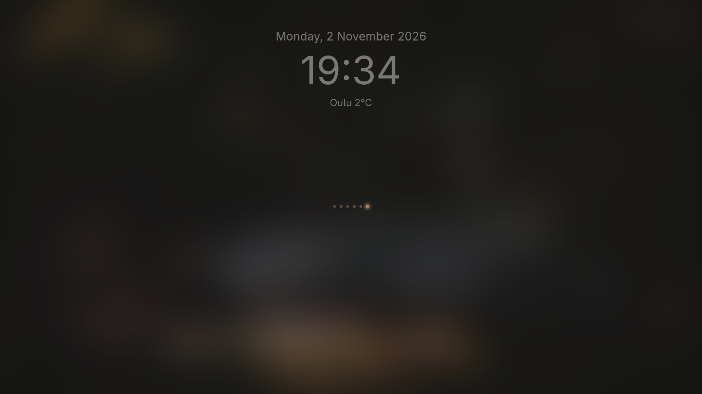

# Dotfiles


My Arch Linux setup: a [Niri](https://github.com/YaLTeR/niri) desktop with my custom [Quickshell](https://quickshell.org/) 

<p align="center">
  
</p>

## Philosophy

- **Keyboard driven.** If a widget has buttons, it must also work from the keyboard.
- **Less clutter.** A clear working environment, no giant menus.
- **Simplicity.** Small scripts and plain config files over big frameworks.
- **Speed before eye candy.** Animations are short, and memory use is something I actually watch.

## Stack

|  | |
| ------------------------ | --------------------------------------------------------------------------- |
| Distro                   | [Arch Linux](https://archlinux.org), BTW                                |
| Compositor               | [Niri](https://github.com/YaLTeR/niri), Compositor     |
| Shell  | [Quickshell](https://quickshell.org/), Bar, menus, lock, wallpaper etc.|
| Colors                   | [Hellwal](https://github.com/danihek/hellwal), Like Matugen but better  | 
| Terminal                 | [WezTerm](https://wezterm.org/), Works as terminal and tmux like persistent multiplaxer         |
| Editor                   | [Neovim](https://neovim.io/)                                             |
| File manager             | [lf](https://github.com/gokcehan/lf/), |
| Image viewer             | [swayimg](https://github.com/artemsen/swayimg), Best inage viewer in wayland |
| Media                    | [mpv](https://mpv.io/)                              |
| Login manager            | [ly](https://codeberg.org/fairyglade/ly)                                    |
| Shell                    | bash                                                                        |

## Gallery

<table>
  <tr>
    <td width="50%"><br><sub>Zen mode: bar hidden, only a small info card in the corner</sub></td>
    <td width="50%"><br><sub>Application launcher (apps, files, emoji, calculator)</sub></td>
  </tr>
  <tr>
    <td width="50%"><br><sub>Clipboard picker</sub></td>
    <td width="50%"><br><sub>Translator</sub></td>
  </tr>
  <tr>
    <td width="50%"><br><sub>Wallpaper picker</sub></td>
    <td width="50%"><br><sub>Audio controls</sub></td>
  </tr>
  <tr>
    <td width="50%"><br><sub>Bluetooth menu</sub></td>
    <td width="50%"><br><sub>Network menu</sub></td>
  </tr>
  <tr>
    <td width="50%"><br><sub>Notification history</sub></td>
    <td width="50%"><br><sub>Weather forecast</sub></td>
  </tr>
</table>

<p align="center">
  <br>
  <sub>Lock screen</sub>
</p>

### Slimshell (Quickshell)

One Quickshell process replaces what used to be a pile of separate tools and increasingly complicated Bash scripts. It lives in [`core/.config/quickshell`](core/.config/quickshell)

|              | What's included                                                                                               |
| ------------ | ------------------------------------------------------------------------------------------------------------- |
| **Bar**      | Workspaces, window title, clock and weather, battery, connections, privacy indicators, removable drives, tray |
| **Menus**    | Keyboard-driven Bluetooth, Wi-Fi, audio, power and notification menus                                         |
| **Launcher** | Apps, file search, calculator, emoji, and a dmenu-compatible mode for scripts                                 |
| **Tools**    | Clipboard history, DeepL translator, screen recording, package updates                                        |
| **Session**  | Lock screen, idle handling, polkit prompt, wallpaper picker, dynamic theming                                  |

Everything is controlled over IPC, so Niri keybinds and scripts just call it:

```bash
qs ipc call launcher toggle
qs ipc call volume up
qs ipc call lock lock
```

The full target list is in the [Slimshell README](core/.config/quickshell/README.md).

## Install
> These are personal dotfiles. Read before you copy, and expect to adapt things for your own.
>
> I do not provide any guarantee if your house burns down or you lose your valuable data!
>
> **You have been warned! ⚠️**

Requires [GNU Stow](https://www.gnu.org/software/stow/)

```bash
git clone git@github.com:bitterhalt/dotfiles.git "$HOME/dotfiles"
DOTFILES="$HOME/dotfiles"

ln -sfn "$DOTFILES/core/.stowrc" ~/.stowrc
cd "$DOTFILES"
stow -R apps bin core
```
